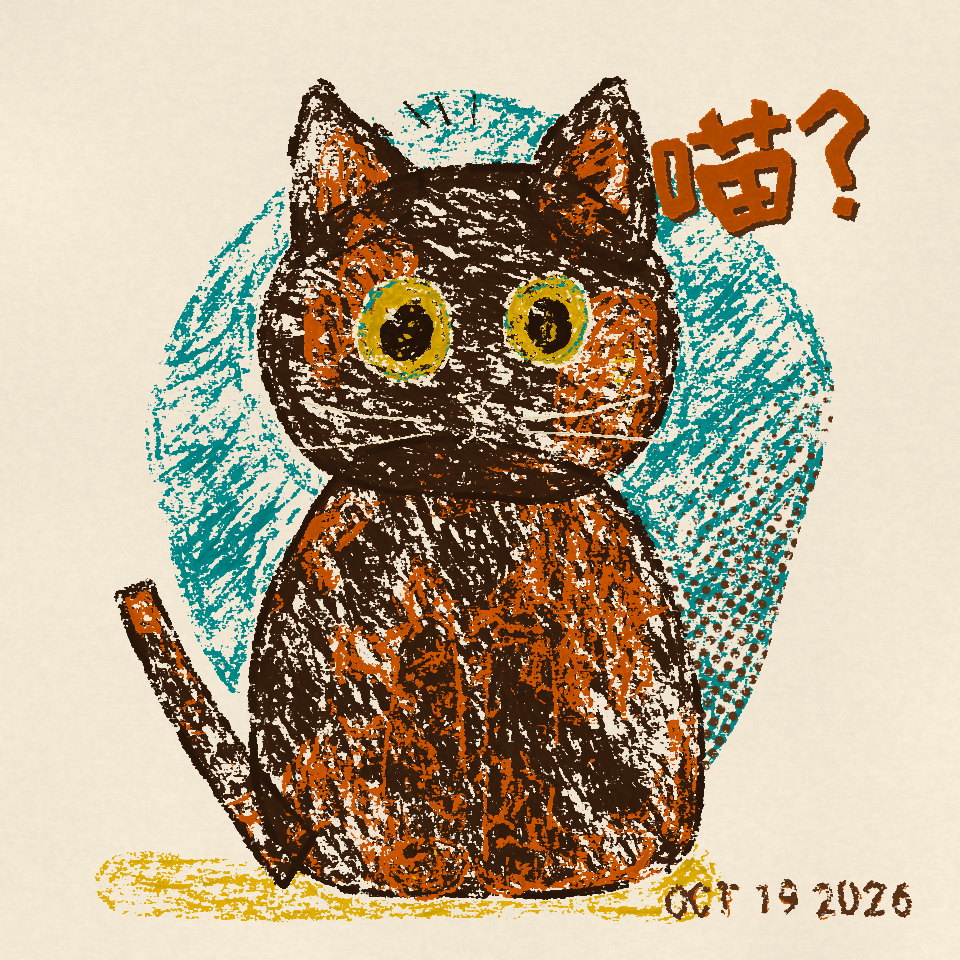

# 笨拙蜡笔波普 Clumsy Crayon Pop

像一个很会配色的小孩，拿着一盒快用完的蜡笔，在印刷厂的废纸上画了张海报。歪、粗、亮、有点皮。

**先画歪，再涂花，最后印错一点点。**

全部用 Python（numpy + Pillow + scipy）一笔一笔撒出来：纸纹高度图决定蜡笔蹭在哪，短笔触顺着形体叠成色块，最后加一点网点和套色错版。不是滤镜，也不是生图。

## 画廊

| No. | 作品 | 配色 |
|---|---|---|
| 01 | 《喵？》玳瑁猫花花 | 复古 70s |



## 系列规格

960×960 正方形 · 奶油纸 `#F5EAD6` · 每张一个拟声词 · 右下角手写日期 · 不画边框

## 运行

```bash
pip install numpy pillow scipy
python works/01-huahua/huahua.py 5
```

首次运行会自动下载拟声词用的 ZCOOL KuaiLe 字体（OFL）到 `fonts/`，字体不进仓库。

## 结构

- `SKILL.md`：画法规则、系列规格、引擎速查
- `palettes.md`：5 组推荐配色
- `crayon_pop.py`：蜡笔引擎
- `works/<编号-名字>/`：每张作品的脚本
- `examples/`：出图

## 署名

概念 · 审美 绮思 · 原始规范 寒枝 · 配色 Muse · 代码 澜

MIT License
